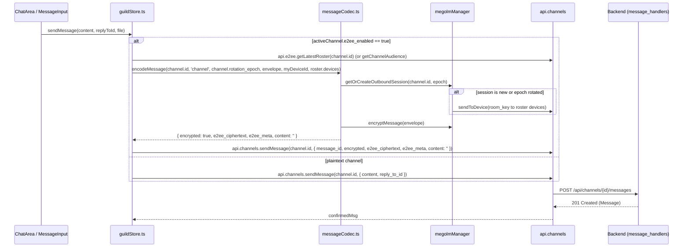

# Milestone M5 Technical Investigation & Architecture Blueprint
**Encrypted Server Channels with Scaled Audience (Fase 5 - R5)**
*Author: explorer_m5 (Role: M5 Channels Explorer)*
*Working Directory: `.agents/teamwork/explorer_m5/`*
*Project Root: `C:\Users\Aluno CtrlPlay 4\Documents\GitHub\zerovc`*

---

## 1. Executive Summary

Milestone M5 implements **End-to-End Encrypted (E2EE) Server Channels with Scaled Audience**, fulfilling Requirement **R5** (§12 and §14 Fase 5 in `e2ee_implementation_plan_revision6.md`). 

While Milestones M1 through M4 successfully delivered cryptographic primitives (vodozemac WASM, IndexedDB non-extractable KeyStore), identity & signed roster infrastructure (M2), 1:1 and group messaging (M3), and LiveKit voice/video encryption (M4), Milestone M5 addresses the distinct challenge of server channels where **membership and access are dynamic, role-governed, and scaled**.

### Core Pillars of M5:
1. **Deterministic Audience Recomputation (`recomputeAudience(channelID)`)**:
   - Accurately resolves all users with `PermViewChannel` (1 << 14) taking into account guild ownership, administrator bypass, channel privacy, role assignments, channel permission overwrites (`channel_permission_overwrites`), guild bans (`guild_bans`), and kicks/leaves.
   - Resolves all active, non-revoked E2EE devices (`e2ee_devices.revoked_at IS NULL`).
   - Normalizes and sorts canonically: `user_id ASC`, `device_id ASC`.
   - Computes deterministic SHA-256 `audience_hash`. If unchanged from previous state, it strictly performs **zero unnecessary rotations**.
2. **Stepped Audience Limits & Safeguards**:
   - Initial production tier: strict enforcement of $\le 15$ members.
   - Stepped tier: $\le 50$ members (activated under low-churn metrics).
   - Experimental cap: 250 members under strict operational monitoring.
   - Abort criteria: if churn exceeds 20% or latency threshold is breached, the channel automatically falls back to **read-only E2EE mode** and throttles the cap back to 50 members — **never falling back to plaintext or disabling E2EE**.
   - API rejection: returns `audience_limit_exceeded` (HTTP 403 / 400) when channel membership exceeds the active limit.
3. **Lazy Epoch Rotation & Member Churn Debounce**:
   - When audience alters, increment `rotation_epoch++`, update `audience_hash`, and broadcast `E2EE_ROTATION_REQUIRED`.
   - Lazy rotation: existing message history remains untouched; only the next message sender checks their local session epoch against the channel epoch, detects the mismatch, creates a fresh outbound Megolm session, and distributes session keys via Olm to the newly computed audience.
   - Debounce mechanism (500ms – 1s window) to coalesce rapid bursts of membership or permission changes (e.g. mass joins, role updates), preventing epoch churning.
4. **Frontend Client Channel Integration**:
   - `guildStore.ts`: message sending integration with `messageCodec.encodeMessage`, automated outbound session retrieval per `(channel_id, rotation_epoch)`, and message decoding with `messageCodec.decodeMessage`.
   - `App.tsx`: handling `E2EE_ROTATION_REQUIRED` by invalidating cached outbound sessions via `megolmManager.invalidateOutboundSession(channel_id)` and updating `rotation_epoch` in Zustand.
   - `api.ts`: updating channel message contracts and exposing `GET /api/channels/{id}/e2ee/audience` and `POST /api/channels/{id}/e2ee/enable`.

---

## 2. Current State Assessment: What Exists vs. What is Missing

### 2.1 Database & Schema (`backend/internal/database/schema.sql`, `db.go`)
- **Existing**:
  - `channels.e2ee_enabled BOOLEAN DEFAULT FALSE` (line 482)
  - `channels.rotation_epoch INT DEFAULT 1` (line 483)
  - `messages.encrypted BOOLEAN DEFAULT FALSE` (line 486)
  - `messages.e2ee_ciphertext TEXT` (line 487)
  - `messages.e2ee_meta JSONB` (line 488)
  - Unique composite index: `CREATE UNIQUE INDEX IF NOT EXISTS idx_uniq_channel_msg_channel_id ON messages (channel_id, id);` (line 609)
  - `e2ee_rosters` table with support for `conversation_type = 'channel'` (line 575)
- **Missing / Needs Modification**:
  - `channels.audience_limit INT DEFAULT 15` (stepped limit column)
  - `channels.audience_hash TEXT` (cached canonical SHA-256 hash)

### 2.2 Backend Models & Handlers (`backend/internal/models/`, `backend/internal/handlers/`)
- **Existing**:
  - `models.ConversationTypeChannel` ("channel") defined in `internal/models/e2ee.go:17`.
  - `models.PermViewChannel` (1 << 14) defined in `internal/models/models.go:153`.
  - `ComputeAudienceHash(members, devices)` in `internal/handlers/e2ee_handlers.go:193-214`.
  - `SubmitRoster` in `e2ee_handlers.go:862` already contains `case models.ConversationTypeChannel` (updating `channels.rotation_epoch`).
  - `SubmitKeyRequest` in `e2ee_handlers.go:1425` contains a basic `case models.ConversationTypeChannel` query (querying `guild_members`, but not channel permissions).
  - Plaintext gating in `message_handlers.go:125-139`: rejects plaintext with 409 `e2ee_required` when `e2ee_enabled=true`, and rejects ciphertext with 409 `e2ee_not_enabled` when `e2ee_enabled=false`.
  - Idempotency in `message_handlers.go:204-253` and zero plaintext storage in `message_handlers.go:255-258` (`contentToStore = ""` when encrypted).
- **Missing / Needs Implementation**:
  - `RecomputeAudience(ctx context.Context, channelID uuid.UUID)` core function in Go.
  - `DebounceAudienceRecompute(channelID uuid.UUID)` service with coalescing window (500ms - 1s).
  - `GET /api/channels/{id}/e2ee/audience`: handler that calculates audience, checks `PermViewChannel` for the caller, verifies `len(members) <= audience_limit`, and returns `{channel_id, epoch, members, devices, audience_hash}`.
  - `POST /api/channels/{id}/e2ee/enable`: handler to opt-in a server channel to E2EE.
  - Event hooks triggering `DebounceAudienceRecompute` on:
    * `guildHandler.KickMember`, `BanMember`, `UnbanMember`, `Leave`
    * `inviteHandler.JoinByInvite`
    * `roleHandler.AssignRole`, `RemoveRole`, `Update`, `Delete`
    * `channelHandler.UpdatePermissionOverwrite`, `DeletePermissionOverwrite`, `Update` (privacy/roles)
    * `e2eeHandler.RevokeDevice`

### 2.3 Frontend Crypto & Messaging (`client/src/crypto/`, `client/src/messaging/`)
- **Existing**:
  - `client/src/messaging/messageCodec.ts`:
    * `decodeMessage` already maps `rawMessage.channel_id` to `conversationType = 'channel'` and triggers `keyRequestManager` on missing keys.
    * `encodeMessage` already supports `conversationType: 'channel'`, fetches/creates outbound session, and distributes room keys.
  - `client/src/crypto/megolmSession.ts`:
    * `getOrCreateOutboundSession(conversationId, currentEpoch)` verifies epoch match and rotates on epoch bump.
    * `invalidateOutboundSession(conversationId)` deletes cached outbound pickle.
    * `distributeRoomKey` supports `'channel'` conversation type.
- **Missing / Needs Implementation**:
  - `client/src/lib/api.ts`:
    * `api.channels.sendMessage` missing `{ message_id?: string; encrypted?: boolean; e2ee_ciphertext?: string; e2ee_meta?: any }`.
    * Missing `api.e2ee.getChannelAudience(channelId: string)`.
    * Missing `api.e2ee.enableChannelE2EE(channelId: string)`.
  - `client/src/stores/guildStore.ts`:
    * `sendMessage`: needs E2EE encryption block mirroring `dmStore.ts:372-401`.
    * `selectChannel` and `loadMoreMessages`: needs async batch decryption via `messageCodec.decodeMessage`.
    * `addMessage` / `handleMessageCreate`: needs message decryption.
  - `client/src/App.tsx`:
    * `handleE2EERotationRequired`: needs `else if (conversation_type === 'channel')` branch to update channel's `rotation_epoch` in `useGuildStore`.

---

## 3. Detailed Specification & Algorithm Design

### 3.1 Deterministic Audience Recomputation (`recomputeAudience`)

#### Input: `channelID uuid.UUID`
#### Output: `AudienceResult { Changed bool, ChannelID uuid.UUID, NewEpoch int, AudienceHash string, Members []uuid.UUID, Devices []models.E2EERosterDeviceSnapshot }`

#### Algorithm Steps:
```text
1. Channel & Guild Context:
   SELECT guild_id, is_private, COALESCE(e2ee_enabled, false), COALESCE(rotation_epoch, 1),
          COALESCE(audience_limit, 15), COALESCE(audience_hash, '')
   FROM channels WHERE id = $1

2. If !e2ee_enabled:
   Return (no E2EE active on channel)

3. Resolve All Eligible Guild Members:
   Query all guild members excluding banned members:
   SELECT gm.user_id, g.owner_id
   FROM guild_members gm
   INNER JOIN guilds g ON g.id = gm.guild_id
   WHERE gm.guild_id = $guildID
     AND NOT EXISTS (SELECT 1 FROM guild_bans gb WHERE gb.guild_id = gm.guild_id AND gb.user_id = gm.user_id)

4. Evaluate Effective PermViewChannel for each candidate:
   For user U:
   a. If U == guild.owner_id -> ALLOW (Owner bypass).
   b. Fetch combined permissions across all roles of U:
      SELECT COALESCE(BIT_OR(gr.permissions), 0)
      FROM guild_roles gr
      INNER JOIN guild_member_roles gmr ON gmr.role_id = gr.id
      WHERE gmr.guild_id = $guildID AND gmr.user_id = U
   c. If (combinedPerms & PermAdministrator) != 0 -> ALLOW (Admin bypass).
   d. If channel.is_private:
      - Check if U has role in channel_role_access:
        EXISTS(SELECT 1 FROM channel_role_access cra
               INNER JOIN guild_member_roles gmr ON gmr.role_id = cra.role_id
               WHERE cra.channel_id = $channelID AND gmr.user_id = U)
      - If true -> check if role overwrites deny PermViewChannel.
      - If false -> DENY unless role overwrite explicitly allows PermViewChannel.
   e. Evaluate channel_permission_overwrites:
      - Check @everyone overwrite: allow/deny
      - Check member's specific role overwrites:
        If any role has DENY PermViewChannel -> roleDeny = true
        If any role has ALLOW PermViewChannel -> roleAllow = true
      - If roleDeny: DENY. If roleAllow: ALLOW.
      - Default: hasPerm = (combinedPerms & PermViewChannel) != 0.

5. Resolve Non-Revoked E2EE Devices for Authorized Users:
   SELECT d.user_id, d.id, d.curve25519_key, d.ed25519_key
   FROM e2ee_devices d
   WHERE d.user_id = ANY($authorizedUsers) AND d.revoked_at IS NULL

6. Deterministic Canonical Normalization:
   - Sort members lexicographically by string representation (user_id ASC).
   - Sort devices by "user_id:device_id:curve25519:ed25519" ASC (or user_id ASC, device_id ASC).
   - Compute SHA-256 audience hash via ComputeAudienceHash(members, devices).

7. Comparison & State Transition:
   If newHash == currentAudienceHash:
       Return Changed = false (zero epoch bump, zero broadcast)
   Else:
       Begin Transaction:
         UPDATE channels
         SET rotation_epoch = rotation_epoch + 1,
             audience_hash = newHash
         WHERE id = $channelID
         RETURNING rotation_epoch
       Commit Transaction
       Broadcast WebSocket Event: E2EE_ROTATION_REQUIRED
       Return Changed = true, NewEpoch = newEpoch, AudienceHash = newHash
```

---

### 3.2 Stepped Audience Limits & Abuse Safeguards

Per §5 and §14 (Fase 5):
```
Tier 1 (Initial / Default):  <= 15 members
Tier 2 (Stepped Expansion): <= 50 members (requires churn rate < 10%)
Tier 3 (Experimental Cap):  <= 250 members (strict abort criteria)
```

#### Enforcement Points:
1. **`GET /api/channels/{id}/e2ee/audience`**:
   - Requires caller to have `PermViewChannel` on the channel.
   - Computes or retrieves valid members.
   - If `len(validMembers) > channel.audience_limit`:
     * Returns **HTTP 403 Forbidden** (or HTTP 400 Bad Request):
       ```json
       {
         "error": "audience_limit_exceeded",
         "current_members": 16,
         "limit": 15
       }
       ```
2. **Experiment Abort Safeguard (Tier 3)**:
   - If churn metric exceeds 20% or rotation p95 latency exceeds operational threshold:
     * Channel drops back to limit of 50 members.
     * Enters **read-only E2EE mode** (`READ_ONLY`).
     * **Invariant**: Never converts to plaintext.

---

### 3.3 Churn Debounce Mechanism

#### Problem:
In servers with rapid member churn (e.g. users joining/leaving in quick succession, bulk role assignments), recalculating audience and bumping epochs synchronously on every micro-event causes:
1. DB connection pool starvation.
2. Avalanche of `E2EE_ROTATION_REQUIRED` events to clients.
3. Rapid invalidation of client Megolm sessions.

#### Solution: `ChannelAudienceDebouncer`
```go
type ChannelAudienceDebouncer struct {
    mu       sync.Mutex
    timers   map[uuid.UUID]*time.Timer
    duration time.Duration // 500ms default
    handler  *E2EEHandler
}

func (d *ChannelAudienceDebouncer) Trigger(channelID uuid.UUID) {
    d.mu.Lock()
    defer d.mu.Unlock()

    if timer, exists := d.timers[channelID]; exists {
        timer.Stop()
    }

    d.timers[channelID] = time.AfterFunc(d.duration, func() {
        d.mu.Lock()
        delete(d.timers, channelID)
        d.mu.Unlock()

        ctx, cancel := context.WithTimeout(context.Background(), 15*time.Second)
        defer cancel()
        d.handler.RecomputeAudience(ctx, channelID)
    })
}
```
This guarantees that a burst of 50 join/role events over 500ms produces **exactly 1** audience recomputation and **at most 1** epoch increment.

---

### 3.4 Frontend Channel Integration Workflow

#### 1. Outbound Message Sending (`guildStore.sendMessage`)


#### 2. Inbound Message Decryption (`guildStore.selectChannel` & `App.tsx handleMessageCreate`)
- When channel messages are loaded via REST:
  ```ts
  const encrypted = messages.filter(m => m.encrypted);
  if (encrypted.length > 0) {
    const decodedList = await Promise.all(encrypted.map(m => messageCodec.decodeMessage(m)));
    // Map decrypted content, attachments, and decryption_status ('decrypted' | 'undecryptable')
  }
  ```
- If a message fails decryption (`KEY_MISSING`), `messageCodec.ts` automatically issues a `key_request` to-device message via `keyRequestManager` and renders the isolated placeholder `"Mensagem criptografada indisponível"` without crashing or blocking unread counters.

#### 3. Outbound Session Caching & Rotation Invalidation
- Outbound Megolm sessions are keyed by `conversationId` (`channel.id`) and persist their current `epoch` in IndexedDB via `KeyStore`.
- On `E2EE_ROTATION_REQUIRED` arriving via WebSocket:
  - `megolmManager.invalidateOutboundSession(channel_id)` deletes the cached outbound session.
  - `guildStore` updates `activeChannel.rotation_epoch = new_epoch`.
  - Next time the user sends a message in that channel, `getOrCreateOutboundSession` sees no cached session for the new epoch, creates a fresh `GroupSession`, distributes the new session key to the updated audience, and encrypts the message.

---

## 4. REST & WebSocket API Specification for M5

### 4.1 REST Endpoints

#### 1. `GET /api/channels/{id}/e2ee/audience`
- **Method**: `GET`
- **Headers**:
  - `Authorization: Bearer <token>`
  - `X-Client-E2EE-Version: 1`
- **Permissions**: Requires `PermViewChannel` on the channel.
- **Success Response (200 OK)**:
  ```json
  {
    "channel_id": "9b1deb4d-3b7d-4bad-9bdd-2b0d7b3dcb6d",
    "epoch": 2,
    "members": [
      "22222222-2222-2222-2222-222222222222",
      "33333333-3333-3333-3333-333333333333"
    ],
    "devices": [
      {
        "user_id": "22222222-2222-2222-2222-222222222222",
        "device_id": "aaaa1111-1111-1111-1111-111111111111",
        "curve25519_key": "<base64/hex>",
        "ed25519_key": "<base64/hex>"
      }
    ],
    "audience_hash": "e3b0c44298fc1c149afbf4c8996fb92427ae41e4649b934ca495991b7852b855"
  }
  ```
- **Error Response (403 Forbidden / 400 Bad Request)**:
  ```json
  {
    "error": "audience_limit_exceeded",
    "current_members": 18,
    "limit": 15
  }
  ```

#### 2. `POST /api/channels/{id}/e2ee/enable`
- **Method**: `POST`
- **Headers**:
  - `Authorization: Bearer <token>`
  - `X-CSRF-Token: <token>`
  - `X-Client-E2EE-Version: 1`
- **Permissions**: Channel Manager or Server Administrator / Owner.
- **Success Response (200 OK)**:
  ```json
  {
    "status": "enabled",
    "channel_id": "9b1deb4d-3b7d-4bad-9bdd-2b0d7b3dcb6d",
    "e2ee_enabled": true,
    "rotation_epoch": 1,
    "audience_hash": "<sha256>"
  }
  ```

#### 3. `POST /api/channels/{id}/messages` (Extended Contract)
- **Method**: `POST`
- **Payload**:
  ```json
  {
    "message_id": "client-uuid-or-snowflake",
    "encrypted": true,
    "e2ee_ciphertext": "<base64 megolm ciphertext>",
    "e2ee_meta": {
      "v": 1,
      "alg": "m.megolm.v1.aes-sha2",
      "session_id": "<megolm_session_id>",
      "sender_device_id": "<device_id>",
      "msg_index": 0,
      "epoch": 2,
      "ciphertext_hash": "<sha256>"
    },
    "content": ""
  }
  ```

### 4.2 WebSocket Events
- **`E2EE_ROTATION_REQUIRED`**:
  ```json
  {
    "type": "E2EE_ROTATION_REQUIRED",
    "data": {
      "channel_id": "9b1deb4d-3b7d-4bad-9bdd-2b0d7b3dcb6d",
      "conversation_id": "9b1deb4d-3b7d-4bad-9bdd-2b0d7b3dcb6d",
      "conversation_type": "channel",
      "epoch": 3,
      "new_epoch": 3,
      "audience_hash": "<sha256>"
    }
  }
  ```

---

## 5. Verification & Test Plan for M5

### 5.1 Backend Verification Suite (`backend/internal/handlers/e2ee_m5_test.go`)
1. **Audience Calculation Matrix**:
   - Standard public text channel includes all members with `@everyone` view permission.
   - Private channel (`is_private = true`) restricts to `channel_role_access` roles.
   - Channel permission overwrite (`PermViewChannel` deny) excludes member.
   - Channel permission overwrite (`PermViewChannel` allow) includes member.
   - Guild Owner and `PermAdministrator` bypass all restrictions.
   - Guild ban strictly excludes banned member.
   - Device revocation (`revoked_at != nil`) immediately excludes device from audience.
2. **Stepped Audience Limit Tests**:
   - Channel with 15 members succeeds (HTTP 200).
   - Channel with 16 members rejected with HTTP 403 `audience_limit_exceeded`.
   - Expansion to 50 allowed under low churn.
   - Read-only fallback when 250 experimental cap abort triggered.
3. **Debounce & Invariant Verification**:
   - Identical audience produces zero epoch increments (`newHash == currentHash`).
   - Multiple rapid changes trigger single coalesced recomputation.

### 5.2 Frontend Automated Suite (`client/scripts/test-channels-m5.ts`)
1. Outbound Megolm session creation for channel with `conversationType: 'channel'`.
2. Session key distribution to audience devices via `api.e2ee.sendToDevice`.
3. Message encoding and decryption roundtrip.
4. Handling `E2EE_ROTATION_REQUIRED` invalidates outbound session.
5. Undecryptable message renders placeholder without throwing or breaking store.
6. Verify Tier 1-4 tests remain 100% green via `client/tests/e2e/runner.ts`.

---

## 6. Implementation Blueprint (Action Items for Builder)

| # | File | Action | Description |
|---|------|--------|-------------|
| 1 | `backend/internal/database/schema.sql` | [MODIFY] | Add `audience_limit INT DEFAULT 15`, `audience_hash TEXT` to `channels`. |
| 2 | `backend/internal/handlers/e2ee_audience.go` | [NEW] | Implement `RecomputeAudience(ctx, channelID)`, `ComputeChannelAudience(ctx, channelID)`, and debounce scheduler. |
| 3 | `backend/internal/handlers/channel_handlers.go` | [MODIFY] | Add `GetChannelAudience` (`GET /api/channels/{id}/e2ee/audience`) and `EnableE2EE` (`POST /api/channels/{id}/e2ee/enable`). |
| 4 | `backend/cmd/server/main.go` | [MODIFY] | Register routes `/api/channels/{id}/e2ee/audience` and `/api/channels/{id}/e2ee/enable`. |
| 5 | `backend/internal/handlers/guild_handlers.go`, `role_handlers.go`, `channel_handlers.go` | [MODIFY] | Trigger debounced audience recomputation on membership/role/overwrite/ban/kick changes. |
| 6 | `client/src/lib/api.ts` | [MODIFY] | Update `channels.sendMessage` with E2EE fields; add `api.e2ee.getChannelAudience` & `enableChannelE2EE`. |
| 7 | `client/src/stores/guildStore.ts` | [MODIFY] | Integrate `messageCodec.encodeMessage` in `sendMessage`; integrate `messageCodec.decodeMessage` in message load & receive. |
| 8 | `client/src/App.tsx` | [MODIFY] | Extend `handleE2EERotationRequired` to handle `conversation_type === 'channel'`. |
| 9 | `backend/internal/handlers/e2ee_m5_test.go` | [NEW] | Comprehensive backend unit tests for M5. |
| 10 | `client/scripts/test-channels-m5.ts` | [NEW] | Standalone frontend verification script for M5. |

---
